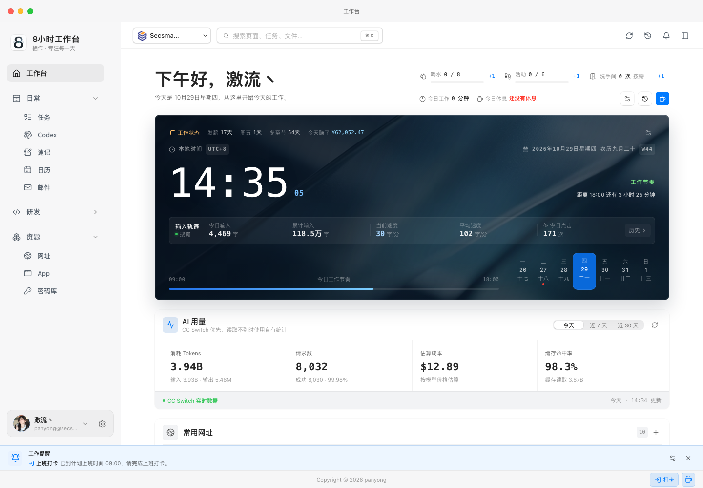
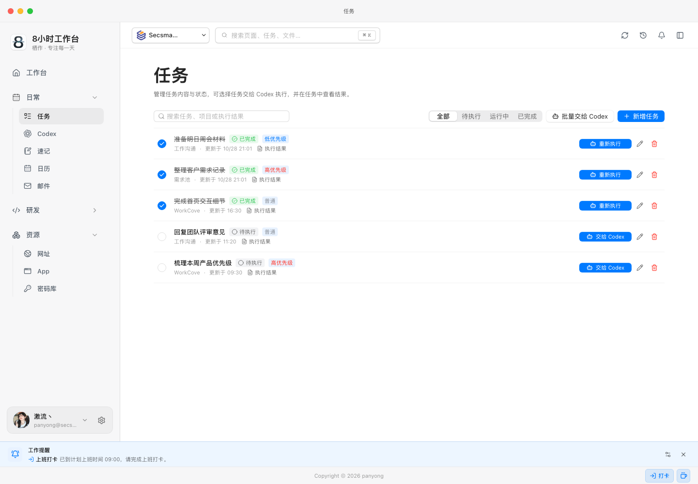
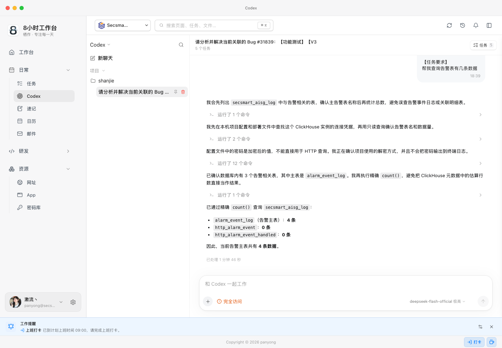
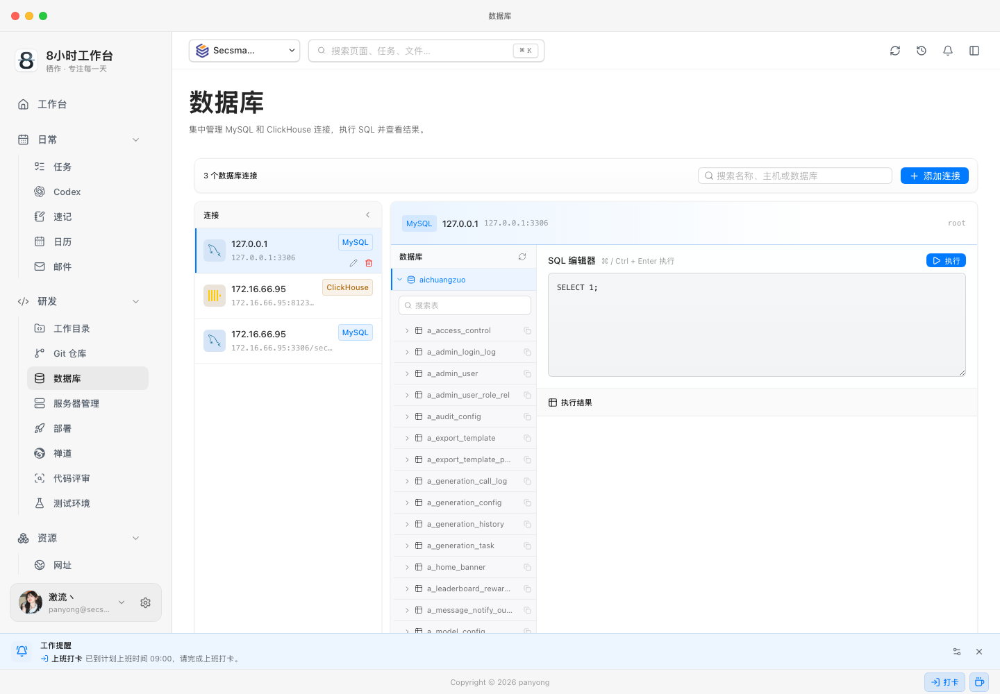
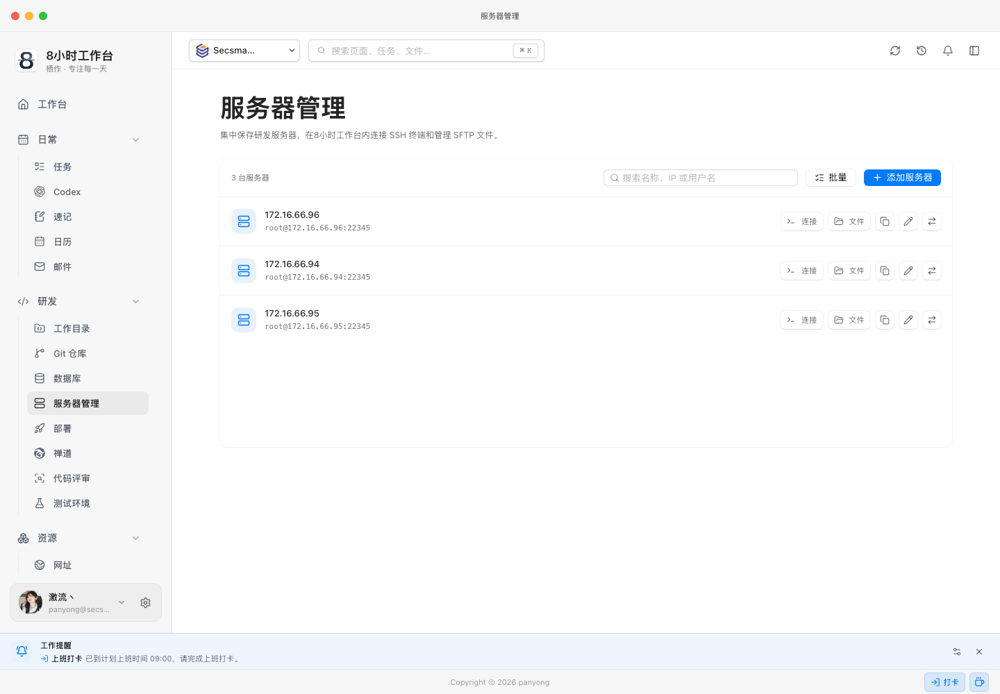
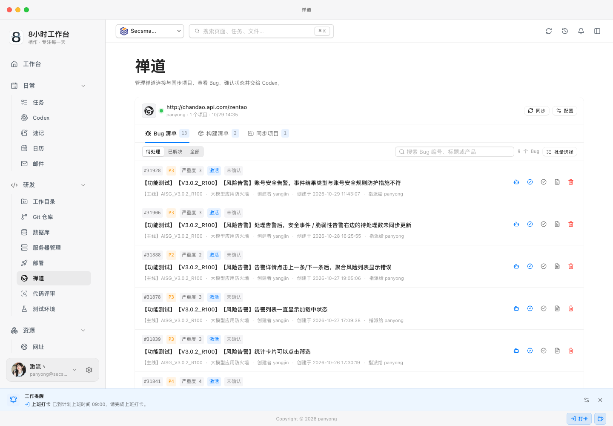
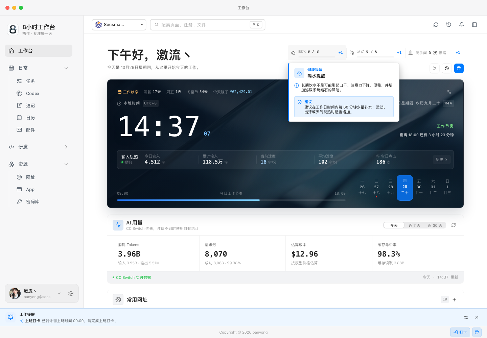

# 8小时工作台

**把 Codex、研发工具和日常专注管理放进一个本地优先的桌面工作台。**

8小时工作台（仓库名 WorkCove）面向每天需要写代码、查资料、处理 Bug、连接服务器和安排日程的研发人员。它把分散在浏览器标签、终端、聊天窗口和多个管理后台里的工作动作，收拢到同一个本地工作空间中。



## 它解决什么问题

研发工作通常不是被某一个大任务打断的，而是被不断切换上下文消耗掉的：

- Codex 在一个窗口里，Git、数据库和服务端在另外几个窗口里；
- 任务、笔记、日程和邮件没有统一入口，重要上下文容易丢失；
- 本地密码、服务器凭据和 Token 用量散落在各处；
- 开发版和客户端版共用环境时，调试操作容易影响日常使用。

8小时工作台不试图替代所有专业工具，而是把每天高频发生的动作组织成一条连续的工作流：记录任务、交给 Codex、查看代码和数据库、提交测试、回到工作台继续下一件事。

## 核心能力

| 模块 | 你可以在这里完成 |
| --- | --- |
| 专注工作台 | 工作时钟、上下班打卡、专注输入轨迹、AI Token 用量、关怀记录和常用网址 |
| Codex 工作区 | 创建会话、连续对话、任务队列、文件和图片附件、执行过程记录、Bug 测试与代码修复 |
| 研发工具 | 工作目录、Git 仓库、数据库连接、部署、代码评审和测试环境 |
| 服务器管理 | 内置 SSH 终端、SFTP 文件管理、快捷命令和主机指纹校验 |
| 禅道闭环 | 同步 Bug、确认 Bug、创建构建、提交测试单，并把 Bug 交给 Codex 验证或修复 |
| 日程协作 | 日历、提醒、任务、邮件、速记和跨模块跳转 |
| 本地安全 | 密码库、Touch ID、AES-GCM 凭据加密、账号与工作空间隔离 |

## 产品截图

以下截图来自当前开发环境，展示的是最新界面和真实交互状态。

### 01 任务与专注工作台

工作台把“今天要做什么”和“今天已经做了多少”放在同一个视图中。任务可以独立维护，也可以直接交给 Codex 执行；工作时钟同时记录输入轨迹、近期 AI Token 使用量和关怀数据。



### 02 Codex 工作区

Codex 不是孤立的聊天框。每个会话会绑定工作目录和当前分支，任务可以排队执行，文件和图片可以作为上下文带入；执行过程、命令、修改结果和状态会保留在时间线里。



### 03 研发工具

工作目录、Git、数据库、部署和代码评审共用同一套工作空间上下文。可以在本地查看仓库状态、执行 SQL、检查目录统计，也可以从研发记录直接继续到 Codex。



### 04 本地研发连接

常用服务器集中保存在工作空间中，可以直接打开内置 SSH 终端和 SFTP 文件管理。服务器凭据只在后端解密使用，SSH 主机指纹首次连接时记录，后续发生变化会拒绝连接。



### 05 禅道闭环

禅道页面可以查看同步的 Bug 和构建记录。创建构建后，构建会直接写入禅道；选择一条构建即可提交测试单。Bug 详情还可以交给 Codex 进行研发环境验证，并保留测试结果和截图证据。



### 06 工作关怀

工作台会在工作时间内提醒喝水、起身活动和休息，并记录最近的工作节奏。提醒时间和上下班打卡时间可以在设置里配置。



## 本地优先

- 核心业务数据保存在本机 MySQL，开发版使用 `workcove`，客户端版使用独立的 `workcove_client`。
- Codex 通过本机 CLI 执行，工作目录、分支和任务上下文由当前用户与工作空间共同约束。
- 邮箱、禅道、Git 远端和服务器只有在用户配置后才访问；密码和 Token 不通过页面列表返回。
- 服务器密码、邮箱密码、禅道密码和测试环境密码使用 AES-256-GCM 加密保存。
- 密码库支持登录密码或 Touch ID 解锁，解锁会话默认 5 分钟后失效。
- 每个工作空间的数据按登录账号隔离，避免不同账号或环境互相串数据。

## 快速开始

### 环境要求

- Java 17
- Node.js 20+ 与 pnpm
- MySQL 8
- macOS 桌面版支持 Electron

### 启动开发版

项目根目录下执行：

```bash
./deploy/local/start-all.sh
./deploy/local/status.sh
```

启动后访问：

- Web：`http://localhost:32581`
- 后端健康检查：`http://127.0.0.1:8790/actuator/health`
- 日志目录：`log/`

停止服务：

```bash
./deploy/local/stop-all.sh
```

也可以分别启动。后端默认读取 `workcove-boot/src/main/resources/application-local.yml`，该文件不进入 Git：

```bash
java -jar workcove-boot/target/workcove-boot-0.2.6-SNAPSHOT.jar
```

```bash
cd workcove-web
pnpm install
pnpm dev
```

### 客户端版

开发版和客户端版使用独立端口、Cookie、Electron 用户目录和 MySQL schema：

| 项目 | 开发版 | 客户端版 |
| --- | --- | --- |
| 后端端口 | `8790` | `8890` |
| Web 入口 | Vite `localhost:32581` | 内置静态资源 `127.0.0.1:8890` |
| MySQL schema | `workcove` | `workcove_client` |
| Electron 用户目录 | `com.pydlove.workcove.dev` | `com.pydlove.workcove` |
| 登录 Cookie | `workcove_session` | `workcove_client_session` |

首次安装客户端前创建独立数据库：

```bash
./deploy/local/setup-client-db.sh
```

桌面客户端构建和升级说明见 [workcove-desktop/README.md](workcove-desktop/README.md)。

## 配置说明

### 邮箱验证码

本地默认使用 `log` 模式，验证码写入后端日志：

```text
8小时工作台 development email code: email=..., code=...
```

启用真实 SMTP 时设置环境变量：

```bash
export WORKCOVE_MAIL_MODE=smtp
export WORKCOVE_MAIL_HOST=smtp.example.com
export WORKCOVE_MAIL_PORT=465
export WORKCOVE_MAIL_USERNAME=your-account@example.com
export WORKCOVE_MAIL_PASSWORD=your-smtp-password
```

### 配置加密

敏感配置使用 AES-256-GCM，格式为 `ENC(v1:...)`。主密钥默认位于 `~/.workcove/config.key`，权限必须为 `600`，也可以通过 `WORKCOVE_CONFIG_KEY` 注入。

```bash
printf '%s' '需要加密的值' | node scripts/encrypt-config.mjs encrypt
```

本地配置模板见
[application-local.yml.example](workcove-boot/src/main/resources/application-local.yml.example)。

## 技术架构

```text
Electron desktop shell
        │
        ▼
Vue 3 + Vite  ───────────────  Spring Boot
                                    │
                    ┌───────────────┼────────────────┐
                    ▼               ▼                ▼
                 MySQL 8       本机 Codex CLI     SSH / Git / SMTP
```

```text
WorkCove/
├── workcove-commons/       共享异常与基础构件
├── workcove-core/          领域层与应用层
├── workcove-infrastructure/ MyBatis、Flyway、邮件、SSH、Git 和安全实现
├── workcove-interfaces/    REST Controller 与接口 DTO
├── workcove-boot/          Spring Boot 启动入口
├── workcove-web/           Vue 3 Web 工程
└── workcove-desktop/       Electron 桌面壳、JRE 和客户端运行时
```

更完整的模块边界、数据隔离和安全约束见 [ARCHITECTURE.md](ARCHITECTURE.md)。

## 质量检查

```bash
mvn clean verify

cd workcove-web
pnpm check:ui
pnpm check:isolation
pnpm typecheck
pnpm build
```

前端设计、组件和响应式规范见
[Web 前端样式规范](doc/开发规范/Web前端样式规范.md)。

## 相关文档

- [架构与分包](ARCHITECTURE.md)
- [桌面客户端与升级](workcove-desktop/README.md)
- [前端样式规范](doc/开发规范/Web前端样式规范.md)
- [Git 分支规范](doc/开发规范/Git分支规范.md)
